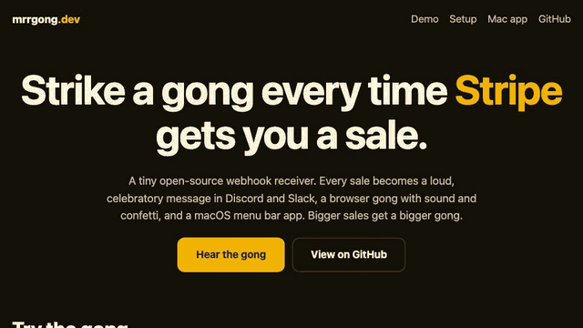

# 🔔 mrrgong.dev

Strike a gong every time Stripe gets you a sale.



[Try the gong in your browser](https://mrrgong.dev) (the landing page lives in [`site/`](site/)).

Stripe webhook → a loud, celebratory message in **Discord** and **Slack**, plus an optional **browser gong** (sound + confetti) for the spare monitor next to your desk. Bigger sales get a bigger gong.

```
🔔 GONG! $49.00 sale
🔔🔔 GONG GONG! $240.00 new subscriber
🔔🔔🔔 GONGGGG!!! 🎉 $2,500.00 sale
```

- **Tiny**: zero runtime dependencies. No Stripe SDK; signatures are verified with Web Crypto.
- **Runs anywhere**: one `Request → Response` handler. Cloudflare Workers, Node, Docker, Bun, Deno.
- **Milestone gongs**: your first sale, your 10th, 100th, 1,000th, and MRR crossing $100, $500, $1k, $5k, $10k, each announced once with the full ceremony.
- **Doesn't double-celebrate**: handles Stripe retries, and the checkout/invoice overlap for subscriptions.
- **Safe by default**: customer emails are masked, customer-controlled text can't `@everyone` or inject Slack links, replayed webhooks are rejected.

## Quick start

1. Make a webhook in Discord (*Channel settings → Integrations → Webhooks*) and/or Slack (*Incoming Webhooks app*).
2. Deploy (below), then in Stripe go to *Developers → Webhooks → Add endpoint* with URL `https://<your-host>/webhook` and these events:
   `checkout.session.completed`, `checkout.session.async_payment_succeeded`, `invoice.paid`. With `GONG_SAD=true` it also reads `charge.refunded` and `customer.subscription.deleted`.
3. Copy the endpoint's signing secret into `STRIPE_WEBHOOK_SECRET`.

### Deploy on Cloudflare Workers (free tier is plenty)

```sh
npm i && npx wrangler secret put STRIPE_WEBHOOK_SECRET
npx wrangler secret put DISCORD_WEBHOOK_URL   # and/or SLACK_WEBHOOK_URL
npx wrangler deploy
```

### Or run the Node server / Docker (adds the browser gong)

```sh
cp .env.example .env   # fill it in
npm i && npm run dev   # or: docker build -t mrrgong . && docker run --env-file .env -p 8787:8787 mrrgong
```

Open `http://localhost:8787/gong`, click **arm the gong** (browsers require a click before playing sound), and leave it on a TV. Set `GONG_TOKEN` if the server is public; the page then lives at `/gong?token=…`.

### Try it without Stripe

```sh
npm run simulate 49      # signed fake $49 sale to localhost:8787
npm run simulate 2500    # hear the big one
npm run simulate -- --mrr 5000   # preview "MRR crossed $5,000" in every channel
npm run simulate -- --sales 100  # preview "100th sale"
stripe listen --forward-to localhost:8787/webhook && stripe trigger checkout.session.completed
```

## Configuration

| Variable | Default | |
|---|---|---|
| `STRIPE_WEBHOOK_SECRET` | required | Endpoint signing secret (`whsec_…`) |
| `DISCORD_WEBHOOK_URL` | – | Must be an `https://discord.com/api/webhooks/…` URL |
| `SLACK_WEBHOOK_URL` | – | Must be an `https://hooks.slack.com/…` URL |
| `GONG_BIG_AT` / `GONG_HUGE_AT` | `100` / `1000` | Major units (dollars, not cents) for the louder tiers. Not currency-converted. |
| `GONG_RENEWALS` | `true` | Set `false` to celebrate only new customers |
| `GONG_SAD` | `false` | Set `true` to log refunds and cancellations quietly (muted message, grey embed, no gong). They never reach public channels like X |
| `GONG_SALE_MILESTONES` | `1,10,100,1000` | Sale counts that get a milestone gong; `none` turns them off |
| `GONG_MRR_MILESTONES` | `100,500,1000,5000,10000` | MRR thresholds in major units (needs `STRIPE_API_KEY`); `none` turns them off |
| `GONG_SALES_SO_FAR` | `0` | Sales you had before installing mrrgong, so an existing shop doesn't announce a "first sale" |
| `GONG_CUSTOMER` | `masked` | `full`, `masked` (name, or `a**@domain.com`), or `none` |
| `STRIPE_API_KEY` | – | Restricted read-only key (`rk_…`). Turns on the MRR watcher |
| `MRR_GOAL`, `MRR_POLL_MINUTES` | –, `15` | Goal in major units; poll interval |
| `PORT`, `GONG_TOKEN` | `8787`, – | Node server only. The token also protects `/mrr` |

Test-mode events are labelled `[TEST]`.

## Milestones

Milestones fire once, ever, and are remembered across restarts. The Node server keeps them in `milestones.json` next to its other state (set a data dir, as for dedupe; without one they reset on restart). If several thresholds are passed at once only the highest is announced. The first MRR reading after a fresh install is recorded silently, so installing mrrgong on a $2k business doesn't celebrate $100, $500 and $1k.

- Only live-mode sales count, and refunds and cancellations never do. Test-mode Stripe keys are not tracked for MRR.
- Milestones go to every channel (Discord, Slack, the browser gong). They contain only amounts and counts, never customer details.
- **Workers:** sale milestones work when the `DEDUPE` KV namespace is bound (the count lives there; KV is eventually consistent, so under a race a milestone can in rare cases be missed or repeated once). Without KV they are off. MRR milestones need the Node server, since Workers have no MRR watcher.
- Rehearse with `npm run simulate -- --mrr 5000` or `-- --sales 100`: previews are signed, test-mode only, and never touch the real counters.

## MRR watcher and day streak (Node server)

Set a **restricted, read-only** Stripe key (Subscriptions: read, nothing else) and the server tracks your MRR:

```sh
STRIPE_API_KEY=rk_live_...   MRR_GOAL=2000   npm run dev
curl localhost:8787/mrr
# {"mrrMinor":124700,"currency":"USD","formatted":"$1,247.00","todayDeltaMinor":2900,"streakDays":12,"goalMinor":200000,"goalPercentLeft":38}
```

- It re-reads Stripe every `MRR_POLL_MINUTES` and right after each celebrated sale, and keeps one snapshot per UTC day in `$GONG_DATA_DIR/mrr-history.json`.
- **Day streak** = consecutive days MRR ended higher than the day before. Today counts once it beats yesterday; being flat so far today doesn't break the streak. A dip (churn) or a missing day does. The number is never faked.
- MRR counts `active` subscriptions only, normalised to a month. Coupons are applied (fixed amounts per invoice, ended ones ignored); metered/tiered prices are skipped. Multi-currency accounts track the biggest currency.
- The streak starts counting from the day you turn it on.
- Connected clients also get an `event: mrr` message on `/events`.

## What counts as a sale

| Stripe event | Celebrated when |
|---|---|
| `checkout.session.completed` / `…async_payment_succeeded` | `mode=payment` and paid |
| `invoice.paid` | amount paid > 0 (first subscription payment = "new subscriber", later = "renewal") |
| `charge.refunded` | only with `GONG_SAD=true`; the latest refund's amount |
| `customer.subscription.deleted` | only with `GONG_SAD=true`; the flat recurring amount that was canceled |

Refunds, failed payments and `payment_intent.succeeded` (which duplicates the above) are ignored.

## Known limits

- Dedupe keys live for 7 days (Stripe retries for 3). Node keeps them in `$GONG_DATA_DIR/dedupe.json` (default `.`; `/data` in Docker, so mount a volume to keep them across container replacement). Workers use the optional `DEDUPE` KV binding in `wrangler.toml`. If the durable store fails, it logs a warning and falls back to memory instead of dropping the sale.
- On Workers there is no browser gong or MRR history (no shared state between isolates). It needs the Node server, or a Durable Object, which is a possible future addition.
- Newer Stripe API versions no longer put `payment_intent` on invoices; dedupe then falls back to the invoice id.

## Development

```sh
npm test         # vitest + coverage
npm run typecheck
npm run build
```

## License

MIT
