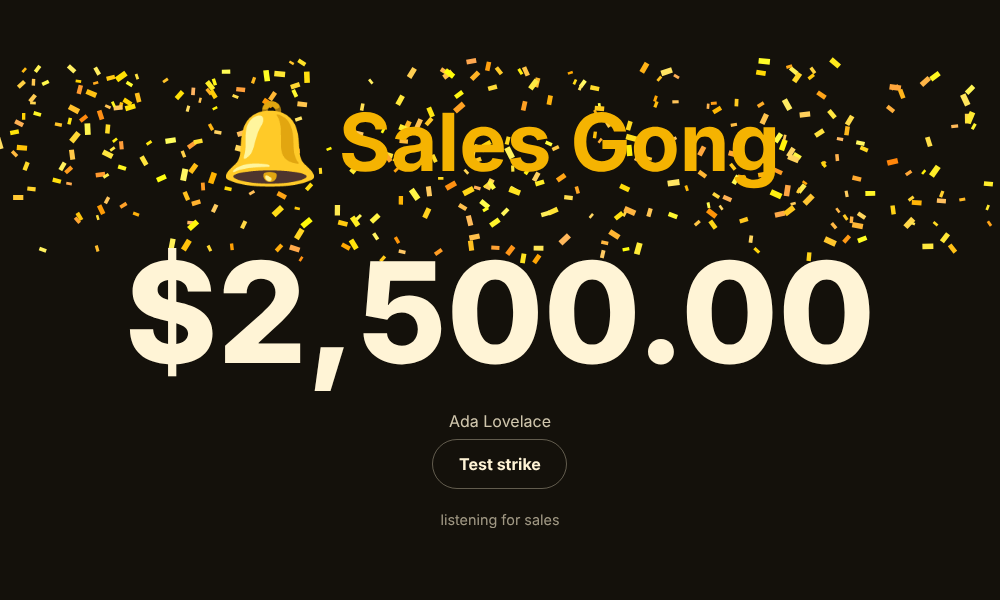

# 🔔 mrrgong.dev

Strike a gong every time Stripe gets you a sale.


[Try the gong in your browser](https://mrrgong.dev) (the landing page lives in [`site/`](site/)).

Stripe webhook → a loud, celebratory message in **Discord** and **Slack**, plus an optional **browser gong** (sound + confetti) for the spare monitor next to your desk. Bigger sales get a bigger gong.

```
🔔 GONG! $49.00 sale
🔔🔔 GONG GONG! $240.00 new subscriber
🔔🔔🔔 GONGGGG!!! 🎉 $2,500.00 sale
```

- **Tiny**: zero runtime dependencies. No Stripe SDK; signatures are verified with Web Crypto.
- **Runs anywhere**: one `Request → Response` handler. Cloudflare Workers, Node, Docker, Bun, Deno.
- **Milestone gongs**: your first sale, your 10th, 100th, 1,000th, and MRR crossing $100, $500, $1k, $5k, $10k, each announced once with the full ceremony.
- **Doesn't double-celebrate**: handles Stripe retries, and the checkout/invoice overlap for subscriptions.
- **Safe by default**: customer emails are masked, customer-controlled text can't `@everyone` or inject Slack links, replayed webhooks are rejected.



## Quick start

1. Make a webhook in Discord (*Channel settings → Integrations → Webhooks*) and/or Slack (*Incoming Webhooks app*).
2. Deploy (below), then in Stripe go to *Developers → Webhooks → Add endpoint* with URL `https://<your-host>/webhook` and these events:
   `checkout.session.completed`, `checkout.session.async_payment_succeeded`, `invoice.paid`.
3. Copy the endpoint's signing secret into `STRIPE_WEBHOOK_SECRET`.

### Deploy on Cloudflare Workers (free tier is plenty)

```sh
npm i && npx wrangler secret put STRIPE_WEBHOOK_SECRET
npx wrangler secret put DISCORD_WEBHOOK_URL   # and/or SLACK_WEBHOOK_URL
npx wrangler deploy
```

To keep dedupe keys and milestone counters across Workers isolates, create a KV namespace and bind it as `GONG_KV`:

```sh
npx wrangler kv namespace create GONG_KV   # then paste the id into wrangler.toml
```

### Or run the Node server / Docker (adds the browser gong)

```sh
cp .env.example .env   # fill it in
npm i && npm run dev   # or: docker build -t mrrgong . && docker run --env-file .env -v mrrgong-data:/data -p 8787:8787 mrrgong
```

Open `http://localhost:8787/gong`, click **arm the gong** (browsers require a click before playing sound), and leave it on a TV. Set `GONG_TOKEN` if the server is public; the page then lives at `/gong?token=…`.

### Try it without Stripe

```sh
npm run simulate 49      # signed fake $49 sale to localhost:8787
npm run simulate 2500    # hear the big one
npm run simulate 29 subscription   # also: renewal, refund, cancel
SIM_LIVE=1 npm run simulate 49     # live-mode event, so it counts towards milestones
stripe listen --forward-to localhost:8787/webhook && stripe trigger checkout.session.completed
```

## Modes, milestones and the other channels

**Modes** (`GONG_MODE`): `calm` (default), `indie` ("MRR go brrr", "Tell your mom") or `broker` ("Sold.", "The phones are ringing"). Each has 10+ lines per tier and never repeats one back to back. Add your own in [`src/copy.ts`](src/copy.ts); PRs welcome.

**Milestones** (on by default, `GONG_MILESTONES=false` to turn off): your first sale, the 10th/100th/1,000th sale, MRR crossing $100, $500, $1k, $5k, $10k, $25k, $50k, $100k, and MRR up 7/30/100/365 days in a row. Each fires once, survives restarts, and counts live-mode sales only. The first MRR reading just records where you already are, so installing at $3k doesn't claim you "just crossed" $1k.

**Sad gong** (`GONG_SAD=true`): refunds and canceled subscriptions, in a muted tone. Private chat channels only; never X.

**Phone push** (`NTFY_TOPIC`): sends to [ntfy](https://ntfy.sh). Anyone who knows the topic name can read it on the public server, so use a long random one, or self-host and set `NTFY_SERVER`.

**X / Twitter** (all four `X_*` keys): posts milestones only, with a customer-free sentence. `X_POST_ALL_OVER=250` also posts sales of $250 and up (amount only, never customer data, never test-mode). Check X's current API write limits and pricing before relying on it.

**AI gong writer** (`ANTHROPIC_API_KEY`, off by default): a fresh one-liner per sale from the amount, size and kind only. It never sees customer names, emails or descriptions, times out after 3 seconds, and falls back to the canned line.

## Configuration

| Variable | Default | |
|---|---|---|
| `STRIPE_WEBHOOK_SECRET` | required | Endpoint signing secret (`whsec_…`) |
| `DISCORD_WEBHOOK_URL` | – | Must be an `https://discord.com/api/webhooks/…` URL |
| `SLACK_WEBHOOK_URL` | – | Must be an `https://hooks.slack.com/…` URL |
| `GONG_BIG_AT` / `GONG_HUGE_AT` | `100` / `1000` | Major units (dollars, not cents) for the louder tiers. Not currency-converted. |
| `GONG_MODE` | `calm` | `calm`, `indie` or `broker` |
| `GONG_MILESTONES` | `true` | First sale, sale counts, MRR and streak milestones |
| `GONG_SAD` | `false` | Announce refunds and canceled subscriptions |
| `NTFY_TOPIC`, `NTFY_SERVER` | –, `https://ntfy.sh` | Phone push |
| `X_API_KEY`, `X_API_SECRET`, `X_ACCESS_TOKEN`, `X_ACCESS_SECRET` | – | All four, or none. Milestones go to X |
| `X_POST_ALL_OVER` | – | Also post sales of at least this many major units |
| `ANTHROPIC_API_KEY`, `GONG_AI_MODEL` | –, `claude-haiku-5-5` | Optional AI line writer |
| `GONG_RENEWALS` | `true` | Set `false` to celebrate only new customers |
| `GONG_CUSTOMER` | `masked` | `full`, `masked` (name, or `a**@domain.com`), or `none` |
| `STRIPE_API_KEY` | – | Restricted read-only key (`rk_…`). Turns on the MRR watcher |
| `MRR_GOAL`, `MRR_POLL_MINUTES` | –, `15` | Goal in major units; poll interval |
| `PORT`, `GONG_TOKEN` | `8787`, – | Node server only. The token also protects `/mrr` |

Test-mode events are labelled `[TEST]`.

## Milestones

Milestones fire once, ever, and are remembered across restarts. The Node server keeps them in `milestones.json` next to its other state (set a data dir, as for dedupe; without one they reset on restart). If several thresholds are passed at once only the highest is announced. The first MRR reading after a fresh install is recorded silently, so installing mrrgong on a $2k business doesn't celebrate $100, $500 and $1k.

- Only live-mode sales count, and refunds and cancellations never do. Test-mode Stripe keys are not tracked for MRR.
- Milestones go to every channel (Discord, Slack, the browser gong). They contain only amounts and counts, never customer details.
- **Workers:** sale milestones work when the `DEDUPE` KV namespace is bound (the count lives there; KV is eventually consistent, so under a race a milestone can in rare cases be missed or repeated once). Without KV they are off. MRR milestones need the Node server, since Workers have no MRR watcher.
- Rehearse with `npm run simulate -- --mrr 5000` or `-- --sales 100`: previews are signed, test-mode only, and never touch the real counters.

## MRR watcher and day streak (Node server)

Set a **restricted, read-only** Stripe key (Subscriptions: read, nothing else) and the server tracks your MRR:

```sh
STRIPE_API_KEY=rk_live_...   MRR_GOAL=2000   npm run dev
curl localhost:8787/mrr
# {"mrrMinor":124700,"currency":"USD","formatted":"$1,247.00","todayDeltaMinor":2900,"streakDays":12,"goalMinor":200000,"goalPercentLeft":38}
```

- It re-reads Stripe every `MRR_POLL_MINUTES` and right after each celebrated sale, and keeps one snapshot per UTC day in `mrr-history.json`.
- **Day streak** = consecutive days MRR ended higher than the day before. Today counts once it beats yesterday; being flat so far today doesn't break the streak. A dip (churn) or a missing day does. The number is never faked.
- MRR counts `active` subscriptions only, normalised to a month. Percentage and fixed coupons are applied (one-off and ended coupons are ignored); metered/tiered prices are skipped. Multi-currency accounts track the biggest currency.
- The streak starts counting from the day you turn it on.
- Connected clients also get an `event: mrr` message on `/events`.

## What counts as a sale

| Stripe event | Celebrated when |
|---|---|
| `checkout.session.completed` / `…async_payment_succeeded` | `mode=payment` and paid |
| `invoice.paid` | amount paid > 0 (first subscription payment = "new subscriber", later = "renewal") |

Failed payments and `payment_intent.succeeded` (which duplicates the above) are ignored. With `GONG_SAD=true`, `charge.refunded` and `customer.subscription.deleted` also count; add them to your Stripe endpoint's events if you want them.

## Known limits

- Dedupe keys and milestone counters live in `mrrgong-state.json` in `GONG_DATA_DIR` (Node; the Docker image uses the `/data` volume) or the `GONG_KV` namespace (Workers). Without KV, a different Workers isolate can in rare cases re-announce a retried event. KV is not atomic, so two sales landing at the same instant could skip a count milestone.
- On Workers there is no browser gong, MRR watcher or MRR/streak milestones (sale-count milestones work) (no shared state between isolates). It needs the Node server, or a Durable Object, which is a possible future addition.
- Newer Stripe API versions no longer put `payment_intent` on invoices; dedupe then falls back to the invoice id.

## Development

```sh
npm test         # vitest + coverage
npm run typecheck
npm run build
```

## License

MIT
