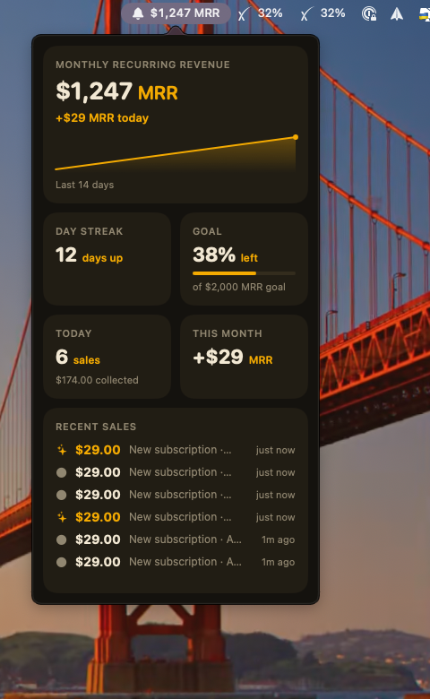

# MRR Gong for macOS

A menu bar app for [mrrgong.dev](https://mrrgong.dev). It shows your MRR next to a bell, and strikes a gong every time a sale lands.



## Requirements

- macOS 14 or later
- Xcode 16+ (the full Xcode, not just the Command Line Tools: SwiftUI and AppKit need its SDK)
- A running mrrgong server (see the repo root). Default: `http://localhost:8787`

No third-party dependencies.

## Build and run

```bash
cd apps/mac
./scripts/build-app.sh   # produces dist/MRRGong.app (release build, ad-hoc signed)
open dist/MRRGong.app
```

The app is menu bar only (`LSUIElement`), so there is no Dock icon. If `xcode-select` points at the Command Line Tools, the script switches to `/Applications/Xcode.app` for you; set `DEVELOPER_DIR` to use a different Xcode.

For a quick dev loop: `swift run MRRGong`.

## Test

```bash
swift test
swift test --enable-code-coverage   # core logic is about 93% covered, excluding GongPlayer
```

Tests cover JSON decoding, money/relative-time formatting, the SSE parser, reconnect backoff, history and sales persistence, gong synthesis, the HTTP/SSE clients (against a stub `URLProtocol`) and the `AppModel` state machine (with fakes). The AppKit/SwiftUI shell and `GongPlayer` (real audio output) are verified by hand.

## Using it

- **Left-click** the menu bar item: the popover with MRR, today's change, a 14-day sparkline, day streak, goal, today's sales, this month and recent sales.
- **Right-click** for the menu: Strike test gong, Show as desktop widget, Float on top, Open gong wall, Mute sound, Settings, Quit.
- **Settings** takes the server URL and an optional token. The token is stored in your Keychain and sent as `?token=`; the URL and mute state live in `UserDefaults`.
- **Desktop widget** is the same tiles in a borderless panel that sits on the desktop. *Float on top* lifts it above other windows.

If the server is unreachable (or the token is rejected, the watcher is off, or there is no data yet), the popover shows a muted status tile instead of stale numbers.

## How it works

| Piece | Where |
| --- | --- |
| `GET /mrr` polled every 60 s | `MRRClient`, `AppModel.runPollLoop` |
| `GET /events` (SSE) with exponential reconnect (1 s to 30 s) | `SSEClient`, `SSEParser`, `Backoff` |
| Unnamed SSE messages are sales, `event: mrr` refreshes the numbers | `AppModel.handle` |
| Gong: additive sine partials (1, 1.51, 2.03, 2.64, 3.28, 4.7, 6.1 x base), exponential decay | `GongSynth`, `GongPlayer` |
| Tiers: normal 98 Hz x1 strike, big 82 Hz x2, huge 70 Hz x3 (longer ring) | `GongProfile` |
| 14-day sparkline from locally stored daily readings | `MRRHistory` |

Local data (history and recent sales) is kept in `~/Library/Application Support/mrrgong/`.

The status item is an `NSStatusItem` hosting an `NSPopover` with SwiftUI content rather than `MenuBarExtra`, because `MenuBarExtra` cannot offer a separate right-click menu.
